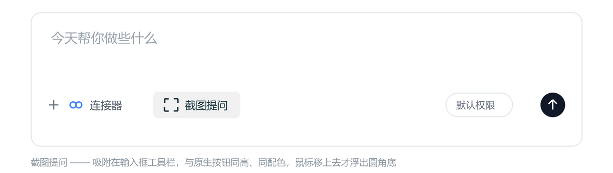

# WorkBuddy 截图提问

> 在 WorkBuddy 输入框旁长出一个「截图提问」按钮：点一下 → 框选 → 松手，截图就已经躺在输入框里了，直接打字发问。

一个 Windows 上的小工具，约 2200 行 Python，无第三方 UI 框架，只用 `tkinter` + `Pillow` + `ctypes` 调 Win32。
它不修改 WorkBuddy 安装目录、不注入进程、不读聊天内容，只是**在窗口上贴一个跟原生工具栏长得一样的按钮**，然后替你把「截图 → 回窗口 → Ctrl+V」这三步做完。

---

## 它省掉的是什么

平时的流程：`Win+Shift+S` 框选 → 切回 WorkBuddy → 点进输入框 → `Ctrl+V` → 有时发现焦点不在输入框，白干。

现在：光标在聊天里任意位置，按 `Ctrl+Alt+Q`（或点按钮）→ 框选 → 松手 → **图已经是附件了**，光标就在输入框末尾，直接打字。

- 不落盘再拖拽，不需要找文件
- 不依赖输入框是否已获得焦点（会自动补一次点击）
- 截图同时存一份到 `截图/`，`latest.png` 永远是最新一张

---

## 功能一览

### 截图与粘贴

| 功能 | 说明 |
|---|---|
| 两种触发 | 点输入框旁的按钮，或任意窗口下按 `Ctrl+Alt+Q` |
| 全屏框选 | 全屏暗化 42%、十字光标；拖动时实时显示选区尺寸（`W × H`），选区内**实时透出原图**，所见即所得 |
| 取消 | `Esc` 或右键；拖得太小（< 8px）自动作废，不会糊你一脸废图 |
| 自动存档 | 每张存进 `截图/`，同时把最新一张复制为 `latest.png` |
| 自动进输入框 | 写剪贴板 → 补一次「点进输入框」→ `Ctrl+V`。**你之前点没点过输入框都不影响** |
| 粘贴可关 | 右键菜单关掉「截完自动粘贴」，就只把图放剪贴板、不动输入框 |
| 静默成功 | 一切正常时不弹任何提示；只有出错才 toast，并告诉你图还在剪贴板 |

### 按钮

| 功能 | 说明 |
|---|---|
| 自动吸附 | 找到工具栏上的「连接器」图标，贴在它右侧，与原生按钮同一行、同一高度（92×32） |
| 自适应宽度 | 内容区窄于 620px 时缩成 32×32，只留取景框图标，不挤压原生控件 |
| 可拖动 | 按住就能拖，位置写进 `config.json`；右键「按钮回到默认位置」一键复位 |
| 主题跟随 | 底色、文字色、hover 色**全部实时采样**，浅色 / 深色 / 彩色主题都能对上；换主题约 1~2 秒内变色；也可在 `config.json` 里手动指定 |
| hover 与原生同色 | 浮出的淡色圆角底取自侧栏「发现应用」胶囊的实测 hover 色，不是「底色压暗」瞎猜 |
| 自动收起 | WorkBuddy 不在前台（切走 / 最小化 / 关闭）时按钮跟着隐藏 |

### 跟随与开销

| 功能 | 说明 |
|---|---|
| 拖动跟手 | 实测位置滞后 4~5px（旧实现 96px），肉眼与窗口同步 |
| 缩放跟随 | 窗口变宽变窄后重新定位，停稳偏差 ±0px，紧凑模式自动切换 |
| 极低开销 | 稳态 CPU 1~2%；运动中每轮约 0.04ms；**运动中完全不截屏** |
| 三档调度 | 运动 6ms / 静止 16ms / 皮肤复核 2.4s，闲时不空转 |

### 常驻与安全

| 功能 | 说明 |
|---|---|
| 开机自启 | 一键写 `HKCU\...\Run`，普通用户权限即可，不需要管理员 |
| 自愈 | 计划任务每分钟兜底，守护进程万一挂了 1 分钟内自动补回；单例锁保证不会开出第二个 |
| 崩溃兜底 | 隐藏窗口前落一个标记文件，异常退出后下次启动自动把窗口救回来；也可双击 `恢复窗口.bat` 手动救 |
| 双日志 | `错误.log` 存完整 traceback；`点击诊断.log` 记每次自动粘贴的落点、落点上是什么窗口、是否跳过 |
| 环境自检 | `--selftest` 一次打印解释器、Pillow、屏幕尺寸、窗口识别与定位结果 |
| 零侵入 | 不修改 WorkBuddy 安装目录、不注入进程、不读聊天内容、不联网上传，图片只在本机流转 |

---

## 界面长什么样



按钮吸附在输入框工具栏里、蓝色「连接器」图标的右侧，**和原生按钮同一行同一高度**：

```
┌─ 输入框 ────────────────────────────────────────────────────┐
│  今天帮你做些什么                                            │
│                                                              │
│  ＋  [◻]连接器  [⌗ 截图提问]  …              [默认权限] [↑]  │
└──────────────────────────────────────────────────────────────┘
                     ↑
        92×32，与原生胶囊同高；宽度不足时自动缩成 32×32 只留图标
```

刻意做成「看不出是外挂」：

- **配色实时采样**：底色、文字色、hover 色都从窗口里量，不写死。换浅色/深色/任何品牌色主题都跟着变
- **hover 与原生同色**：鼠标移上去浮出的淡色圆角底，是探测侧栏「发现应用」胶囊的 hover 色得来的，和旁边按钮完全一致
- **位置实时跟随**：拖窗口、缩放窗口、切成紧凑模式，按钮跟着走，延迟约 5px 内
- **窗口不在前台就收起**：切到别的程序它自动消失，不挡事

---

## 环境要求

| 项目 | 要求 |
|---|---|
| 系统 | Windows 10 / 11（x64）。依赖 DWM、任务计划程序、`ctypes` Win32 API |
| Python | 3.9 或更高（开发与测试在 **3.11** 上完成） |
| 依赖库 | `Pillow`（唯一需要 `pip install` 的包） |
| 其它 | `tkinter`（Windows 官方安装包自带）、WorkBuddy 桌面客户端 |
| 权限 | 普通用户即可，**不需要管理员**（自启写 `HKCU`，任务计划建在当前用户下） |

不支持 macOS / Linux —— 通篇是 Win32 调用。

---

## 安装

```bash
git clone https://github.com/<your-name>/workbuddy-screenshot-qa.git
cd workbuddy-screenshot-qa
pip install -r requirements.txt
```

没有 `pip` 就先装 Python：<https://www.python.org/downloads/>，安装时**勾上 "Add python.exe to PATH"**。

然后双击 **`自检.bat`**，它会打印解释器版本、Pillow 版本、屏幕尺寸、是否找到 WorkBuddy 窗口、定位结果：

```
python : C:\...\Python311\python.exe
pillow : 12.2.0
tkinter: 8.6
virtual screen: 0,0  1920x1160
workbuddy window: ('WorkBuddy', 'workbuddy.exe', (...)) 
locate: connector=(619, 646, 1096) ...
```

看到 `workbuddy window:` 后面不是 `NOT FOUND` 就说明环境 OK。

---

## 使用

1. 双击 **`启动.vbs`**（无控制台窗口，后台常驻）
2. 切到 WorkBuddy，输入框工具栏右侧就会出现「截图提问」按钮
3. 点按钮，或按 `Ctrl+Alt+Q`
4. WorkBuddy 自动隐藏 → 鼠标拖出要截的区域（`Esc` 取消）→ 松手
5. 窗口恢复，截图自动变成输入框附件，直接打字

### 快捷键

| 快捷键 | 作用 |
|---|---|
| `Ctrl+Alt+Q` | 开始截图（全局，任何窗口下都能按） |
| `Ctrl+Alt+X` | 退出本工具 |

### 右键按钮

- 截图提问
- 截完自动粘贴到输入框（可关，关了只把图放剪贴板）
- 开机自动启动
- 按钮回到默认位置
- 使用说明 / 退出

按钮还能**直接拖动**，位置会被记住。

### 开机自启（可选）

双击 **`随WorkBuddy启动.bat`**，它会做两件事：

1. 在 `HKCU\Software\Microsoft\Windows\CurrentVersion\Run` 写一条启动项
2. 注册计划任务 `WorkBuddyScreenshotQA_Guardian`：登录时启动 + 每分钟兜底检查，守护进程万一挂了 1 分钟内自动补回

之后不用再管它，WorkBuddy 一开按钮就在。取消：双击 **`取消自启.bat`**。

---

## 配置

首次运行会在同目录生成 `config.json`，改完重启生效。常用字段：

| 字段 | 默认 | 说明 |
|---|---|---|
| `auto_paste` | `true` | 截完是否自动 Ctrl+V；关掉则只写剪贴板 |
| `click_before_paste` | `true` | 粘贴前先点一下输入框正文，把焦点交进去 |
| `hide_when_inactive` | `true` | WorkBuddy 不在前台时隐藏按钮 |
| `theme` | `"auto"` | `auto` 按窗口实测明暗；可强制 `"light"` / `"dark"` |
| `bg_color` | `""` | 手动指定按钮底色 `"#RRGGBB"`，留空即自动采样 |
| `ink` | `""` | 手动指定文字/图标色，留空自动采样 |
| `hover_bg` | `""` | 手动指定 hover 底色，留空自动采样 |
| `sidebar_w` | `240` | 左侧栏宽度（内容区从此处起算），换布局时可能要调 |
| `compact_below` | `620` | 内容区窄于此值时只显示图标 |
| `connector_gap` | `12` | 按钮左边缘相对「连接器」图标的间距 |
| `offset_x` / `offset_y` | `-60` / `-79` | 测不到图标时的兜底坐标 |
| `moving_ms` | `6` | 拖动/缩放中的轮询间隔（毫秒） |
| `idle_ms` | `16` | 静止时的轮询间隔 |
| `recheck_sec` | `1.6` | 静止时复核锚点位置的间隔（技能区变长靠它跟） |
| `theme_recheck_sec` | `2.4` | 皮肤复核间隔 |

主题色在 0.8~2.4 秒内跟上，所以换主题后按钮会「稍等一下」才变色，这是正常的。

---

## 命令行

```bash
python screenshot_qa.py             # 常驻（有控制台，调试用）
pythonw screenshot_qa.py            # 常驻（无控制台，脚本用的就是它）
python screenshot_qa.py --once      # 只跑一次截图流程
python screenshot_qa.py --selftest  # 环境自检
python screenshot_qa.py --restore   # 救回被隐藏的 WorkBuddy 窗口
python screenshot_qa.py --install-autostart     # 装自启 + 守护任务
python screenshot_qa.py --remove-autostart      # 卸自启 + 守护任务
```

---

## 它是怎么做到的

几个值得一提的点，也是这个项目真正花时间的地方。

**1. 找到「按钮应该待在哪」**
不写死像素。先按可执行名 `workbuddy.exe` 找窗口，再用 `DwmGetWindowAttribute(DWMWA_EXTENDED_FRAME_BOUNDS)` 取**可见**边框（`GetWindowRect` 在最大化时会把 Windows 那圈不可见的 resize 阴影算进去，底边差 8px，按钮就会跟着掉下去）。然后在工具栏所在行扫一遍，识别那个蓝色「连接器」图标，把按钮贴到它右侧。

**2. 让配色跟着主题走**
三个采样器，都从窗口自身取色，不猜：

- `probe_bg`：按钮上方一条 52×5 的窄带取众数 → 底色
- `probe_theme`：**以连接器图标为锚向左**取一段文字带的极值，并过滤掉彩色和与底色同向的像素 → 文字色（深色主题下自动变白）
- `probe_hover_tint`：读侧栏「发现应用」胶囊的 hover 色 → 让按钮的 hover 底和原生按钮一模一样

想当然的做法（「底色压暗一点当 hover 色」）会错：白底主题下原生 hover 是中性浅灰，不是染色。

**3. 跟手到看不出来**
拖动窗口时的延迟原本有 96px，现在是 4~5px。三个原因逐条解决：

- `master.geometry()` 是异步的 → 改用 `SetWindowPos` 直接写位置
- 每次截图 `BitBlt + GetDIBits` 有 ~19ms 硬成本（和区域大小无关）→ **运动中完全不截屏**，只查窗口矩形（约 0.1ms/轮）
- `tkinter.after` 精度约 15.6ms → `timeBeginPeriod(1)` 提到 1ms，并用 6ms 的运动档 / 16ms 的静止档双节奏

稳态 CPU 1~2%，闲置时基本为 0。

**4. 粘贴不落空、也不误点**
先补一次「点进输入框」再发 `Ctrl+V`，落点是**扫出来的空白带中心**（空框落在占位文字上方、有附件时落在缩略图下方、有草稿时落在末行下方），不是猜的坐标。点之前用 `WindowFromPoint` 轮询最多 800ms 确认这一点真被 WorkBuddy 盖住，等不到就**放弃点击**——宁可不粘，也不能把这一下送给桌面图标或聊天里的文件卡片。

---

## 文件

| 文件 | 说明 |
|---|---|
| `screenshot_qa.py` | 全部实现，单文件 |
| `自检.bat` | 环境自检，装完先跑这个 |
| `启动.vbs` | 无窗口启动（推荐日常用） |
| `随WorkBuddy启动.bat` | 装开机自启 + 自愈任务 |
| `取消自启.bat` | 卸开机自启 + 自愈任务 |
| `立即截图.bat` | 跑一次截图就退出，测流程用 |
| `恢复窗口.bat` | 万一 WorkBuddy 被藏了没回来，双击这个 |
| `_find_python.bat` | 被上面几个脚本 `call`，自动定位 Python |
| `config.json` | 运行时生成，本地配置 |

`.bat` / `.vbs` 里没有任何写死的 Python 路径，会依次找 `py -3` → PATH 里的 `python` → 常见安装目录，克隆到别的机器可直接用。

---

## 已知限制

- **只为 WorkBuddy 桌面端做**：按进程名 `workbuddy.exe` 找窗口。换客户端、换 Electron 版本导致工具栏结构大变时，锚点识别可能失准，需要调 `sidebar_w` / `connector_gap`。
- **依赖界面结构**：靠「蓝色连接器图标」和工具栏那一行定位。如果哪天改版把这个图标挪走或改了颜色，按钮会退回兜底坐标（`offset_x` / `offset_y`）。
- **只做截图粘贴**，不做 OCR、不做图片编辑、不读聊天内容。
- 多显示器可用（按虚拟屏幕坐标），但**混合 DPI** 下位置可能有几像素偏差。
- 全局热键用 `RegisterHotKey` 注册，被别的程序占用时会失效（右键菜单仍可用）。

---

## 排障

| 现象 | 处理 |
|---|---|
| 按钮没出现 | 双击 `自检.bat`，看 `workbuddy window` 是否 `NOT FOUND` |
| 按钮位置不对/重叠 | 右键 → 「按钮回到默认位置」；仍不对就调 `config.json` 的 `sidebar_w` |
| 截完图没进输入框 | 看 `点击诊断.log`（每次自动粘贴记 1~2 行：落点、落点上是什么窗口、跳过原因） |
| WorkBuddy 窗口不见了 | 双击 `恢复窗口.bat` |
| 其它异常 | 看 `错误.log`，有完整 traceback |

---

## License

[MIT](LICENSE)

本项目与 WorkBuddy 官方无关，只是个人做的一个提高效率的小工具。
